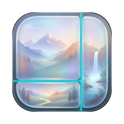

<p align="center">
  
</p>

<h1 align="center">PicPin</h1>

<p align="center">
  <strong>原生液态玻璃质感的 macOS 极简多图拼接工具</strong><br/>
  把多张不同尺寸的照片，快速、无变形地拼成一张构图精准的成片。
</p>

---

## 核心亮点

- **原生 macOS 液态玻璃（Liquid Glass）视觉体验**：基于现代 macOS SwiftUI 与半透明材质打造，悬浮控制栏、胶囊按钮与工作区浑然一体，轻量、通透且响应迅速。
- **告别拉伸变形，所见即所得**：切换任何画布比例时，每张小图始终严格保持原始长宽比。选中画布上的任意小图，即可**直接用鼠标拖拽微调位置**、**用触控板双指捏合（Pinch）**或**按键盘 `+` / `-` 无界缩放**。
- **“全局同步”与“单图精修”一键切换**：默认勾选“应用策略到全局”，一键统一所有图片的缩放与对齐方式；取消勾选即可针对单张图片独立调整倍率与位置。
- **大图秒开，丝滑不卡顿**：内置多级缩略图缓存（列表小图标与画布预览分离）与后台异步图像预解码引擎，同时拼接多张高像素大图依然保持高帧率流畅响应。
- **全格式高质量输出**：原生支持 **`PNG`**、**`JPEG`** 与 Apple **`HEIC`** 格式导出，并提供一键**“复制”**直达系统剪贴板，拼完即贴。

## 功能特性

- **画布与布局**
  - **拼接方向**：横向拼接（并排） / 纵向拼接（长图）
  - **画布比例**：内置 `1:1`、`4:3`、`3:2`、`16:9`、`3:4`、`2:3`、`9:16` 预设，以及自定义宽高比
  - **占比调节**：直接拖拽画布中的分界线微调每张图所占比例（单条最小 `5%`，双击分界线恢复均分）
  - **间距与背景**：支持自定义内边距（Padding）、图间距（Spacing）与画布背景色（支持透明背景）
- **三种缩放模式**
  - **等比撑满（Fill）**：自动铺满分配区域，支持上/中/下或左/中/右预设对齐，以及画布内自由拖拽裁剪位置
  - **完整留白（Fit）**：完整显示整张图片不裁切，支持留白区域对齐与自由拖拽微调
  - **自定义大小（Custom）**：
    - 画布顶部悬浮 **`10% ~ 400%` 滑动条**与 **`25%` / `50%` / `75%` / `100%` / `150%` / `200%`** 六档快捷倍率按钮
    - 支持**触控板双指捏合（Pinch）**与**键盘 `+` / `-` 快捷键**突破 `10% ~ 400%` 范围限制进行无界缩放
- **导出与分享**
  - 支持原始宽度、固定像素宽度（`1080 / 1440 / 2048`）及按原图百分比缩放（`25% / 50% / 75% / 100%`）导出
  - 支持 `PNG`、`JPEG`（质量可调）、`HEIC`（质量可调）及一键复制到剪贴板

## 构建与运行

需要 macOS 14+ 与 Xcode Command Line Tools。

```bash
swift build            # 开发构建
swift test             # 运行单元测试
swift run              # 直接运行
./Scripts/make-app.sh  # 打包 build/PicPin.app（未签名，首次右键打开）
```

## 作者

- **vibe by hewN with GLM & Gemini**
- Weibo: [@heptagonal](https://weibo.com)
- GitHub: [@hewn](https://github.com/hewn)

## License

MIT License
